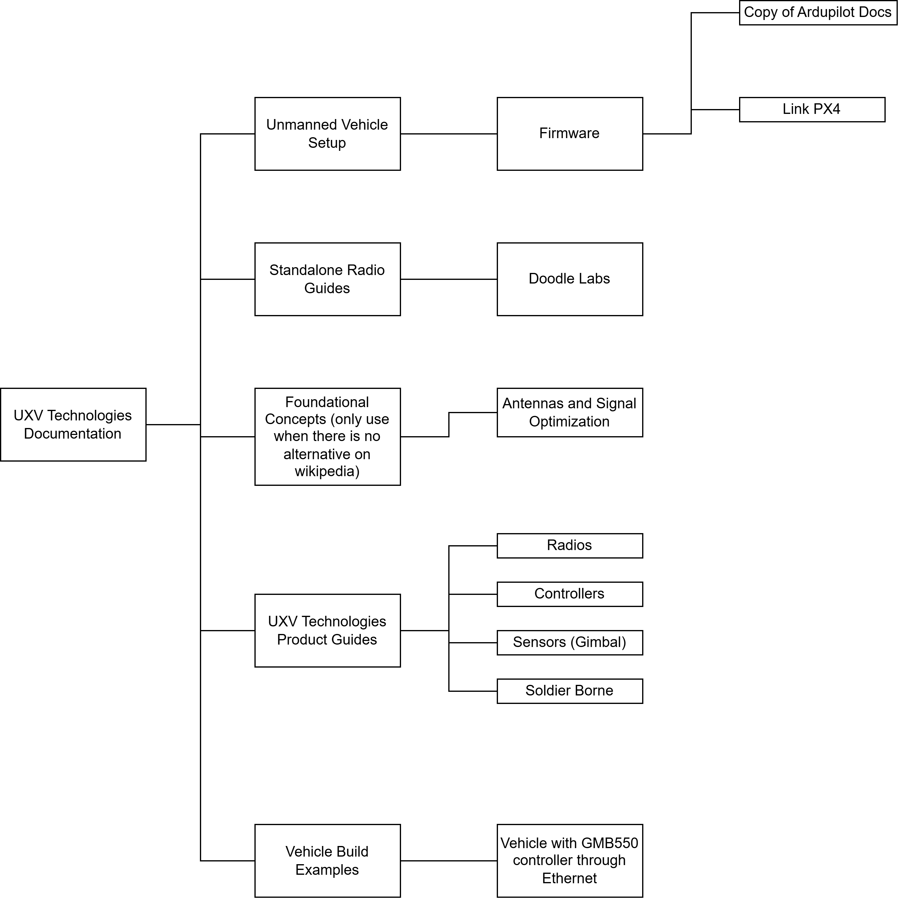

# Documentation Writing Rules

* I will only document what I have personal experience with, not based on information that I found online because it will be incomplete.
* Explained concepts is a part of the documentation I will use to reference in other pages when I need to use a term and do not have space to explain it.
  * The reason is that by making everything myself, I would create a large overhead of maintanance. This way when the original docs are updated, the links lead to the update instead of me having to do it manually.
* Structure of a page
  * Part list
  * Content
  * Expected outcome

<figure><figcaption></figcaption></figure>
