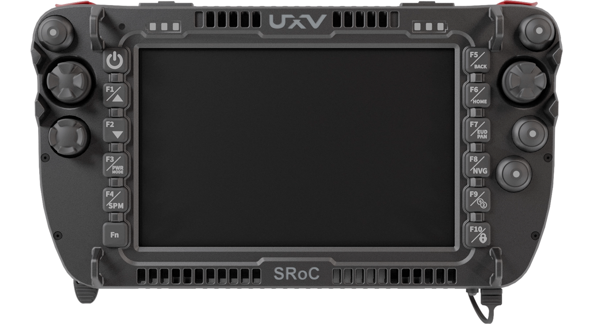
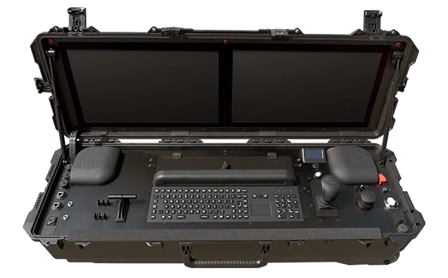
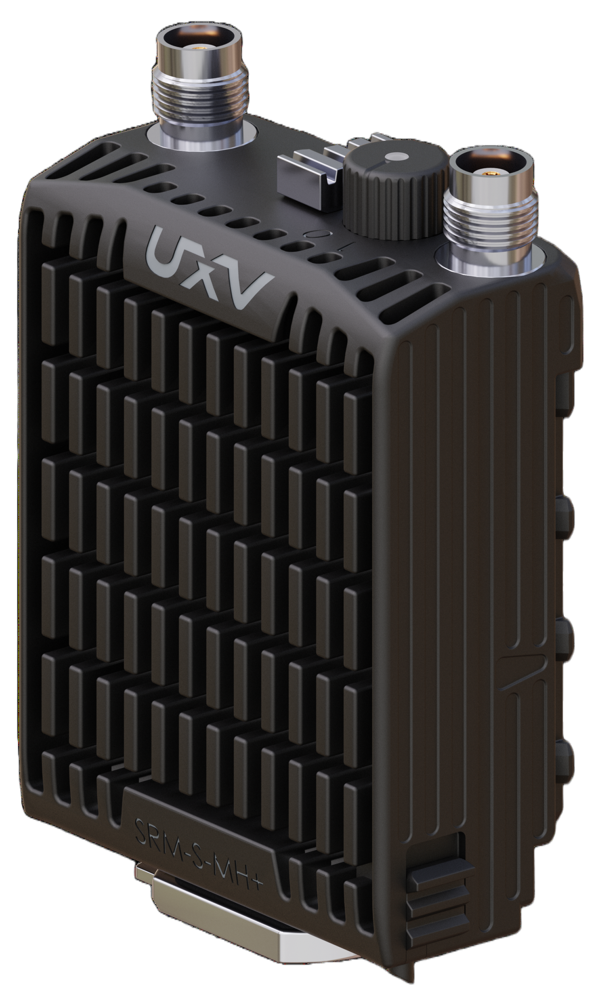
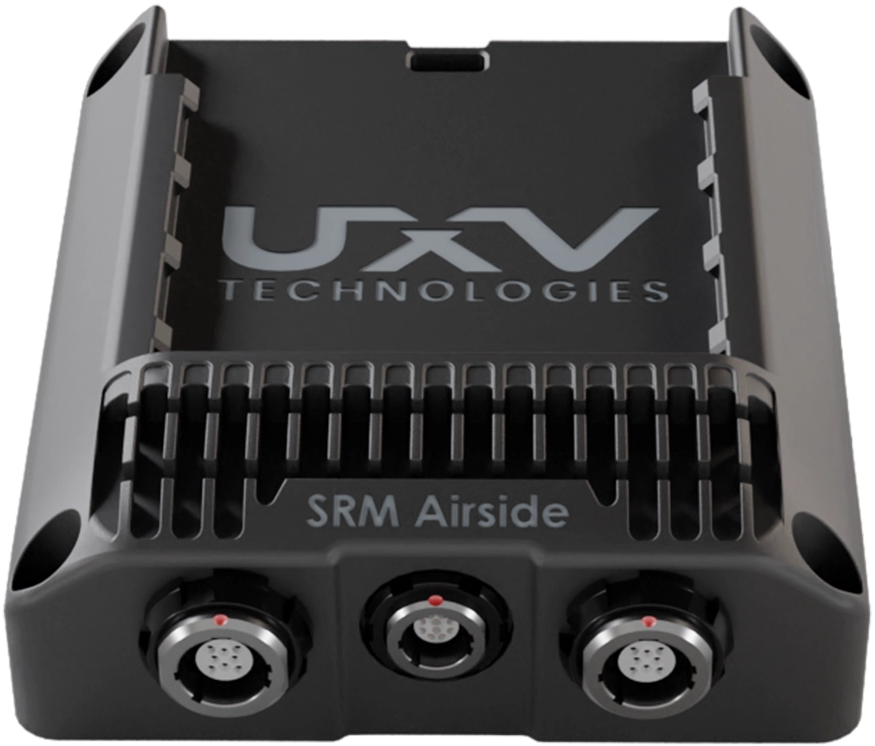

# UXV Technologies

UXV Technologies is a manufacturer of various kinds of technologies and hardware solutions. Our solutions support a wide range of unmanned platforms - including UUVs, USVs, UGVs, and UAVs - playing a crucial role in mission-critical applications globally.

UXV Technologies Products Overview Poster (10/2026)

<figure><figcaption></figcaption></figure>

### [Ground Control Stations (GCS)](https://app.gitbook.com/s/KjNFVuuNpc9Zwv7CH0ci/uxv-technologies-ground-control-stations)



<figure><figcaption>
UXV Technologies SRoC 7" Windows
</figcaption></figure>




<figure><figcaption>
UXV Technologies G2Nav
</figcaption></figure>




### [Communications Equipment](https://app.gitbook.com/s/KjNFVuuNpc9Zwv7CH0ci/uxv-technologies-communication)


{% column width="41.66666666666667%" %}
<figure><figcaption>
UXV Technologies SRM-S-MH+
</figcaption></figure>



{% column width="58.33333333333333%" %}
<figure><figcaption>
UXV Technologies SRM Airside ETH
</figcaption></figure>




### [Sensors - Optroxa Gimbal](https://app.gitbook.com/s/KjNFVuuNpc9Zwv7CH0ci/uxv-technologies-sensors)



<figure><figcaption>
UXV Technologies Optroxa GMB 550
</figcaption></figure>







