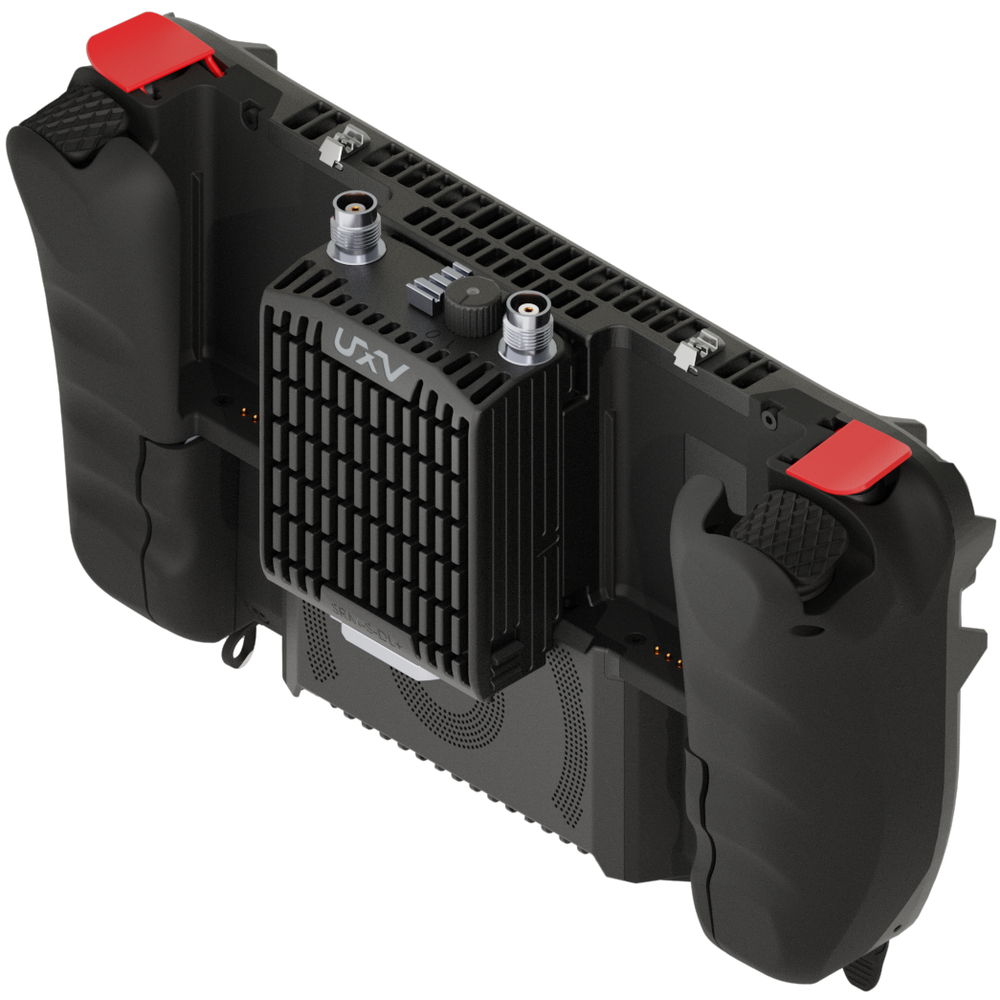
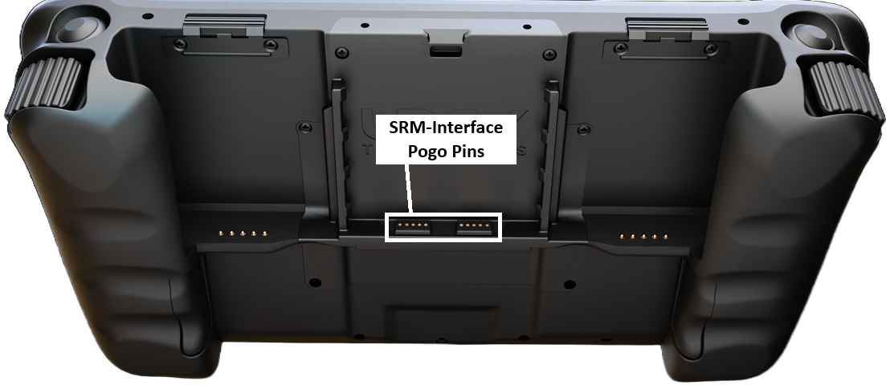

# SRM Interface

Swappable Radio Modules (SRMs) follow a US government standard for defense robotics. UXV Technologies offers more than 30 radio configurations that share the same interface, allowing operators to interchange radios without modifying the ground control station, or the unmanned vehicle.

An SRM Radio can be inserted directly into a compatible interface, as shown below:



<figure><figcaption></figcaption></figure>



{% column width="33.33333333333333%" valign="middle" %}
<figure><figcaption></figcaption></figure>



{% column width="33.33333333333333%" valign="middle" %}
<figure><figcaption></figcaption></figure>




The interface uses spring-loaded pogo-pin contacts to supply power and provide Ethernet connectivity, with USB communication supported on compatible modules.

<figure><figcaption></figcaption></figure>
