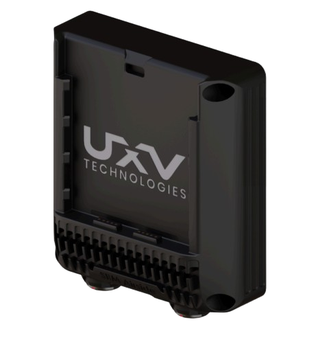
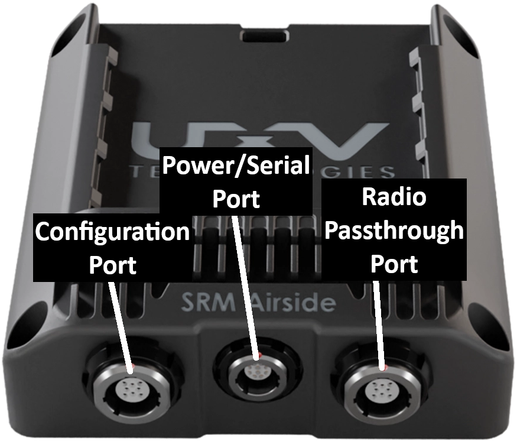
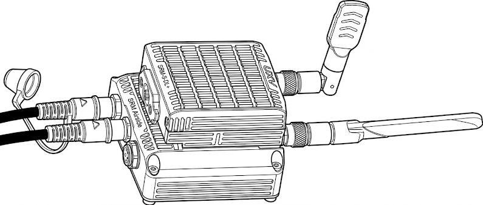

---
layout:
  width: default
  title:
    visible: true
  description:
    visible: true
  tableOfContents:
    visible: true
  outline:
    visible: true
  pagination:
    visible: true
  metadata:
    visible: true
  tags:
    visible: true
  actions:
    visible: true
  anchors:
    visible: true
---

# SRM Airside ETH

The SRM Airside ETH isis a [Linux](https://en.wikipedia.org/wiki/Linux) computer running [OpenWRT](https://en.wikipedia.org/wiki/OpenWrt). It is mounted on a drone/vehicle to make it compatible with the [SRM Radios](../../uxv-technologies-srm-radios/).&#x20;

<figure><figcaption></figcaption></figure>

It can be used as a [network switch](https://en.wikipedia.org/wiki/Network_switch) for an [SRM Radio](../../uxv-technologies-srm-radios/swappable-radio-modules-srm-radios/) and other [ethernet](https://en.wikipedia.org/wiki/Ethernet) connections, such as a [Camera Gimbal](/broken/pages/M0yaFCR0HYV4lMNHHpNt), or a Flight Controller.

## Hardware Overview

It has the following physical ports exposed:

* 2x Ethernet on the ODU G81 - 8 pin
* 1x Ethernet (+ Power to SRM Radio) in the [SRM Interface](../../uxv-technologies-srm-radios/swappable-radio-modules-srm-radios/srm-interface.md)
* 1x Power IN and UART on the ODU G80 - 10 pin


{% column width="58.333333333333336%" %}
<figure><figcaption></figcaption></figure>


{% column width="41.666666666666664%" %}
<figure><figcaption></figcaption></figure>



By default, the first ethernet port on the side is set as a configuration port to directly access the SRM Airside ETH. The second ethernet port is set as a passthrough port for the SRM slot.



<figure><figcaption></figcaption></figure>







## Connection to SRM Airside ETH


The configuration options for the SRM Airside ETH will differ for devices with non-default configuration.


1. Connect an ethernet cable from the Configuration port (ODU S11YAR 8 Pin, see above) to an ethernet port on your computer.&#x20;

<figure><figcaption></figcaption></figure>

2. Connect power (5V - 20V) to the power port (ODU S10YAR 10 Pin) on the SRM Airside ETH.

<figure><figcaption></figcaption></figure>


To prove that the SRM airside is being powered on, put an SRM into the radio slot and observe its power status LED after turning the power switch to ON.


3. Configure your computer

Make sure that the IP 192.168.1.1 is within the IP range of your network adapter.

Wait for about 60 seconds, then the SRM Airside ETH is fully booted up and you can connect to it at 192.168.1.1. The easiest way to do it is through a web browser to access the LuCi web interface. The webpage should look something like the following upon loading:

<figure><figcaption></figcaption></figure>

Alternatively you can also connect to the SRM Airside ETH through Secure Shell ([ssh](https://en.wikipedia.org/wiki/SSH)) using the terminal command `ssh root@192.168.1.1` .&#x20;


If you can acces the SRM Airside ETH through ssh, but not through the browser GUI, try clearing the browser caches. Some browsers will block a connection after several failed attempts.


## Connection to SRM Radio

By default, the second ethernet port is configured as a passthrough to the SRM radio.&#x20;

Use the same ODU S11YAR 8 Pin to RJ-45 cable to connect to the radio through ethernet on your computer.

For software configuration guide, please refer to the [Doodle Labs radio guide](../../standalone-radio-guides/connecting-to-a-doodle-labs-radio.md).

## Integration Notes

In order to use the SRM Airside ETH on a drone/vehicle, it is reccomended to configure it as a [switch](srm-airside-eth-as-a-switch.md) to use both of the ethernet ports.
