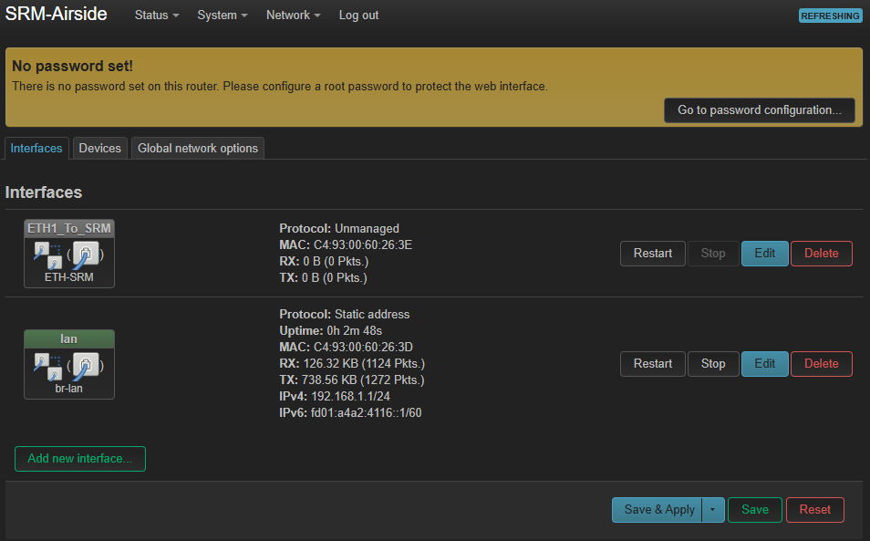

# SRM Airside ETH as a Switch

## Configuration as Ethernet Switch

The guide describes the configuration of the SRM Airside ETH in a specific way to be used as an ethernet switch. For examplee with an ethernet-enabled flight controller and a UXV Technologies Optroxa Gimbal.

### Part list:

* SRM Airside ETH
* 2x [SRM](../../uxv-technologies-srm-radios/swappable-radio-modules-srm-radios/) Radio (This guide uses [SRM-S-DL+](../../uxv-technologies-srm-radios/swappable-radio-modules-srm-radios/srm-s-dl+.md))
* 1x ODU S11YAR 8 Pin to 4-pin JST-GH1.25 with ETH pinout cable
* 1x ODU S11YAR 8 Pin to whatever the GMB550 connector is
* 1x ODU S10YAR 10 Pin to Power Connector (for example XT60)
* 1x [UXV Technologies SROC 7" Windows](../../../uxv-technologies-ground-control-stations/ground-control-stations/uxv-technologies-sroc-7-windows.md)

### Settings Rationale

The settings described in the [following step](srm-airside-eth-as-a-switch.md#id-4.-configuring-srm-airside-eth-network-interfaces) will set the device as a multi-homed router. The following is the reasoning behind it.


A multi-homed router is a router equipped with multiple network interfaces, each of them connected to a different network or a subnet. This allows it to relay traffic between those separate networks, meaning only the target device gets the information without the whole network being flooded by it.


The goal of this setup is to have the SRM Airside ETH function as a DHCP server and assign IP adresses to various devices on the network based on the ports they are connected to. This way the IP of the devices are always the same, which allows the radio, flight controller, or the gimbal to be swapped and the routing will not break.


The device is configured to assign IP adresses on the 10.224.1.1/16 (10.224.x.x) network because Doodle Labs radios function on the 10.223.0.0/16 and giving it another adress on 10.223.0.0/16 would cause an IP overlap and break the connection. Therefore it is possible to use any other adress except that one.


The following setup also divides the network into several segments. This way the packets are only forwarded between the sender and the destination. As a counter example, in a typical topology where all ports are bridged together, all devices receive all communication, which can cause issues in latency of important streams or overwhelm certain devices.


The current setup does not consider security as the firewall is set to forward all. If you wish to add security, it is reccomended to configure the firewall settings first.


### Configuring SRM Airside ETH network interfaces

To implement the settings, log into the web interface and navigate to Network - Interfaces.

<figure><figcaption></figcaption></figure>

The current settings should look like this:

<figure><figcaption></figcaption></figure>

Delete all of the interfaces and create new ones by clicking the "Add new interface" button. Set the basic parameters according to the ones below and click "Create interface."

<figure><figcaption></figcaption></figure>

After the interface is created, edit it through the interfaces tab.

<figure><figcaption></figcaption></figure>

Continue setting all the rest of the parameters listed below:

1. Interface 1 - CAM\_Port
   1. Name: CAM\_Port
   2. Protocol: Static Adress
   3. Device: eth0
   4. General Settings - IPv4 address: 10.224.10.1
   5. General Settings - IPv4 netmask: 255.255.255.0
   6. Firewall Settings - Firewall zone: lan (all port interfaces are there)
   7. DHCP Server - General Setup - Start: 10
   8. DHCP Server - General Setup - Limit: 1
   9. DHCP Server - General Setup - Lease time: 12h
2. Interface 2 - FC\_Port
   1. Name: FC\_Port
   2. Protocol: Static Adress
   3. Device: eth1
   4. General Settings - IPv4 address: 10.224.20.1
   5. General Settings - IPv4 netmask: 255.255.255.0
   6. Firewall Settings - Firewall zone: lan (all port interfaces are there)
   7. DHCP Server - General Setup - Start: 10
   8. DHCP Server - General Setup - Limit: 1
   9. DHCP Server - General Setup - Lease time: 12h
3. Interface 3 - RADIO\_Port
   1. Name: RADIO\_Port
   2. Protocol: Static Adress
   3. Device: eth2
   4. General Settings - IPv4 address: 10.224.30.1
   5. General Settings - IPv4 address: 10.223.10.10/16
   6. General Settings - IPv4 netmask: 255.255.255.0
   7. Firewall Settings - Firewall zone: lan (all port interfaces are there)
   8. DHCP Server - General Setup - Start: 10
   9. DHCP Server - General Setup - Limit: 50
   10. DHCP Server - General Setup - Lease time: 12h
4. Interface 4 - radio\_port\_alias
   1. Name: radio\_port\_alias
   2. Protocol: Static address
   3. Device: Alias Interface @ RADIO\_Port
   4. IPv4 address: 10.223.30.1
   5. IPv4 netmask: 255.255.0.0


The DHCP lease expire time sets how long the DHCP server will keep an IP assigned to a DHCP client without renewal (even if the device is disconnected). During normal operation, DHCP clients renew their lease half of the total lease period, meaning theoretically a lease can last forever.




<figure><figcaption></figcaption></figure>



<figure><figcaption></figcaption></figure>



<figure><figcaption></figcaption></figure>




Please note that the IP addresses on the 10.224.30.1 port will not be assigned based on numerical order. They will be generated based on the DHCP clients MAC address and distributed across the whole subnet. This means that the client is often able to keep its IP even after the DHCP lease has expired.


If you wish to allocate the IP addresses of connected devices based on numerical order instead as a number based on the mac address, navigate to: Network - DHCP and DNS. Scroll down and find a check box labelled "Allocate IPs sequentially." It is not recommended to use because now the IPs are more likely to change specifically when a client's lease is allowed to expire


The alias port (interface 4) was added to alias the IP of the radios on the IP 10.223.0.0/16 to the 10.224.30.1 port. This way the radios get assigned an IP on 10.224.x.x and will keep the 10.223.x.x instead of having both of the IPs overlapping. IP aliasing lets a single physical network interface respond to multiple IP addresses simultaneously, which means that devices on the other side of the radio link and the radios themselves also get assigned IPs on 10.224.30.x.


### Configuring SRM Airside ETH network devices


A network device in OpenWRT is the underlying physical or virtual networking hardware where hardware-specific properties like MAC address are set up.


To change Network Devices settings, navigate to Network - Interfaces - Devices.

<figure><figcaption></figcaption></figure>

### Configuring SRM Airside ETH Firewall

To configure the firewall settings, navigate to Network - Firewall.

<figure><figcaption></figcaption></figure>

In zones, find the LAN row and click on Edit.

<figure><figcaption></figcaption></figure>

Ensure Input, Output and Forward are all set to accept and verify that all of the ports (RADIO, FR, CAM) are listed under covered networks.

<figure><figcaption></figcaption></figure>

### Saving the settings

When you save and apply the settings, you will lose connection to the SRM Airside ETH because its IP adress will change from 192.168.1.1. to 10.224.10/20/30.1 (depending on which port you have the computer connected to.

Previously it was nescessary to set the IP of your computer manually to connect to the device. Now that it works as a DHCP however, you can set your computer as a DHCP client. The computer will now get its IP address assigned from the SRM Airside ETH and you can acces the web interface on its new address again.


If your compuer is set as a DHCP client and sets its address to 169.254.1.1/16, which is the fallback address, it has not received an IP from the DHCP server. Before doing any changes, it is reccomended to wait a minute as booting up the devices on the network can take some time.



Expected outcome: The SRM Airside acts as a DHCP server and lets the ground control station acces all devices on the network at theire assigned IP addresses.

