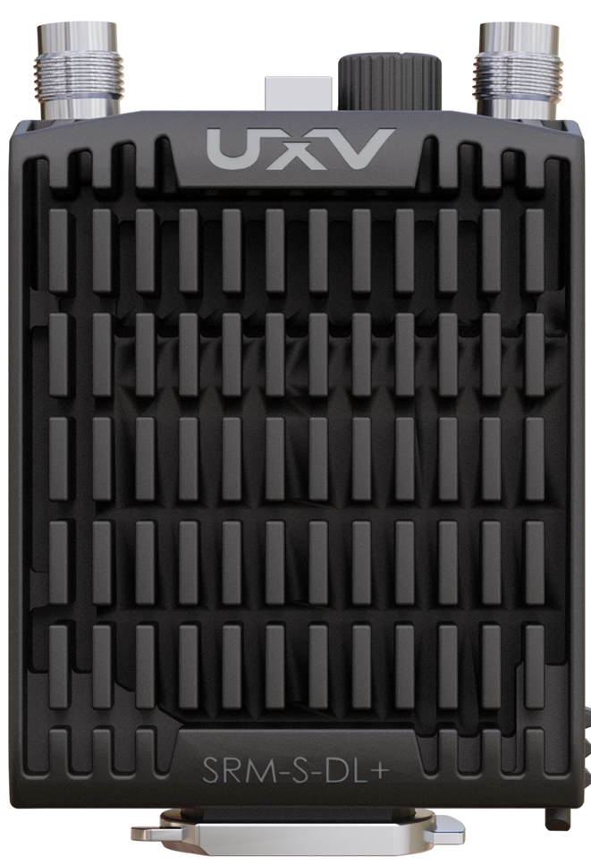
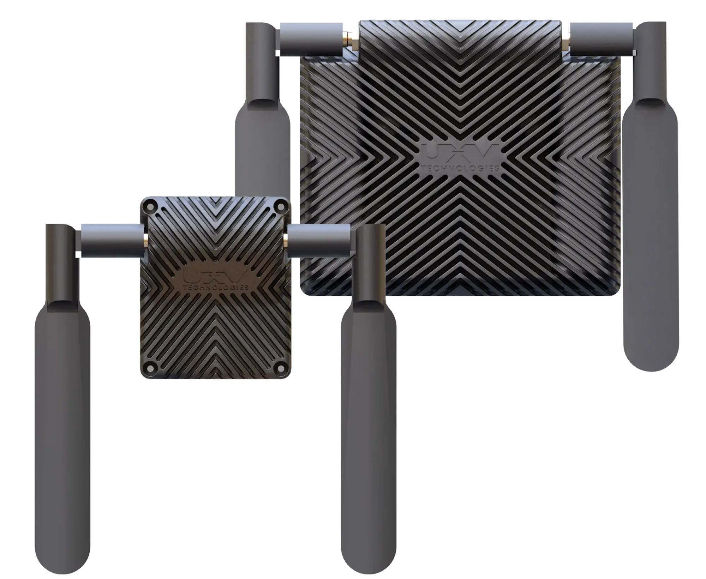

---
layout:
  width: default
  title:
    visible: true
  description:
    visible: true
  tableOfContents:
    visible: true
  outline:
    visible: true
  pagination:
    visible: true
  metadata:
    visible: true
  tags:
    visible: true
  actions:
    visible: true
  anchors:
    visible: true
---

# UXV Technologies SRM/Radios

The UXV Technologies radios integrate standalone radios from various vendors into a ruggedized package.

## Categories of radios:

* UXV Technologies [SRM Radios](swappable-radio-modules-srm-radios/).
  * Compatible with any product with the [SRM Interface](swappable-radio-modules-srm-radios/srm-interface.md).

<figure><figcaption></figcaption></figure>

* UXV Technologies [NavBay radios](https://www.uxvtechnologies.com/communication/navbay-radio).
  * Compatible with UXV Technologies Navigator [Tab 5](https://www.uxvtechnologies.com/ground-control-stations/navigator-tab-5) and (backwards compatible) [Tab 3](https://www.uxvtechnologies.com/ground-control-stations/navigator-tab3) controllers.

<figure><figcaption></figcaption></figure>

