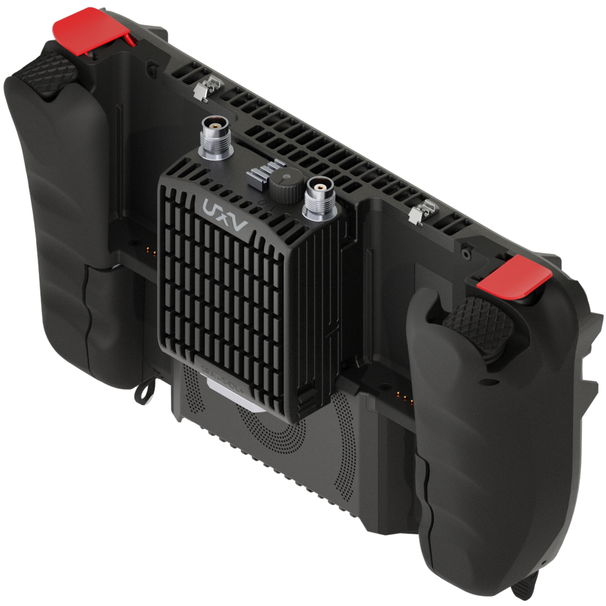
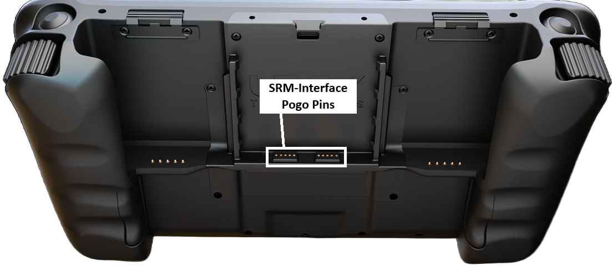

# SRM Interface

Swappable Radio Modules (SRMs) are standardized radio units compliant with a US government standard for defense robotics. Over 30 UXV Technologies configurations share a common interface, allowing operators to interchange radios without modifying the ground control station (GCS) or vehicle.

An SRM Radio can be inserted directly into a compatible interface, as shown below:



<figure><figcaption></figcaption></figure>



{% column width="33.33333333333333%" valign="middle" %}
<figure><figcaption></figcaption></figure>



{% column width="33.33333333333333%" valign="middle" %}
<figure><figcaption></figcaption></figure>




The interface uses spring-loaded pogo-pin contacts to supply power and provide Ethernet connectivity, with USB communication supported on compatible modules.

<figure><figcaption></figcaption></figure>

## Compatible Products

* All radios and radio accessories which have SRM in the name.

### Controllers

* UXV Technologies SRoC 7"
* UXV Technologies Tab 5
* UXV Technologies SRoC S23
* UXV Technologies SRoC S26
* UXV Technologies G2Nav (custom)

