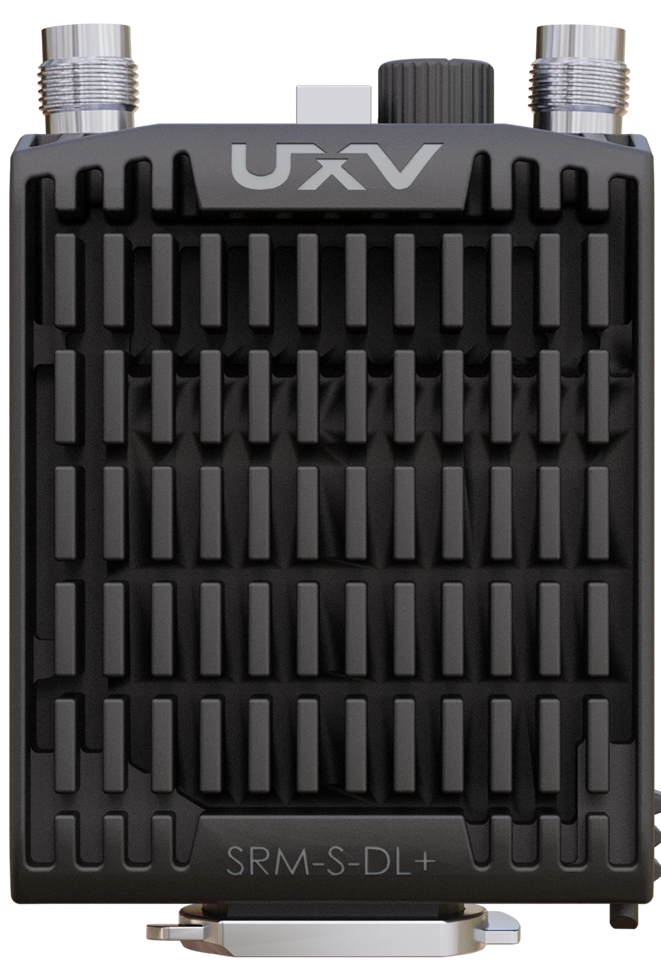
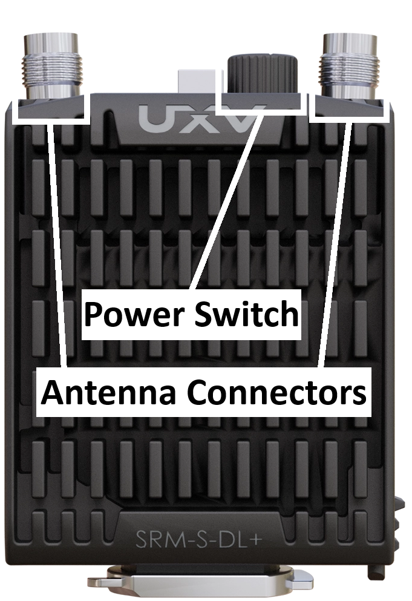
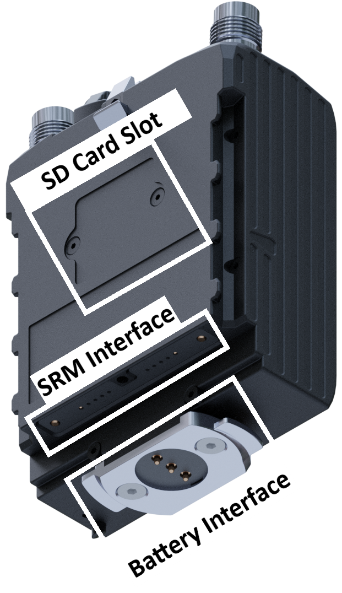

# SRM-S-DL+

The SRM-S-DL+ integrates a Doodle Labs radio into a ruggedised enclosure with an [SRM interface](srm-interface.md).

<figure><figcaption></figcaption></figure>

| Parameter                 | Value                                       |
| ------------------------- | ------------------------------------------- |
| Communication protocols   | Ethernet (serial in special configurations) |
| External twist-on battery | Yes                                         |
| Power via SRM interface   | Yes                                         |
| Antenna connectors        | 2 × female TNC                              |

## Hardware Overview

The top of the SRM-S-DL+ has two female [TNC antenna connectors](https://en.wikipedia.org/wiki/TNC_connector) and a two-position power switch.

<figure><figcaption></figcaption></figure>

The bottom has the SRM interface connector and an external twist-on battery interface. An SD card slot is located on the back of the enclosure.

<figure><figcaption></figcaption></figure>

## Configuration

1. To configure the SRM-S-DL+ using a computer, connect it via Ethernet using the [SRM Airside ETH](../../uxv-technologies-radio-accessories/srm-airside-eth/). Alternatively, connect it using the SRM interface on a UXV Technologies ground control station.
2. Follow the [Connecting to a Doodle Labs Radio](../../standalone-radio-guides/connecting-to-a-doodle-labs-radio.md) guide to configure the radio software.


Check that the power switch is in the correct position so that the radio is getting power.

