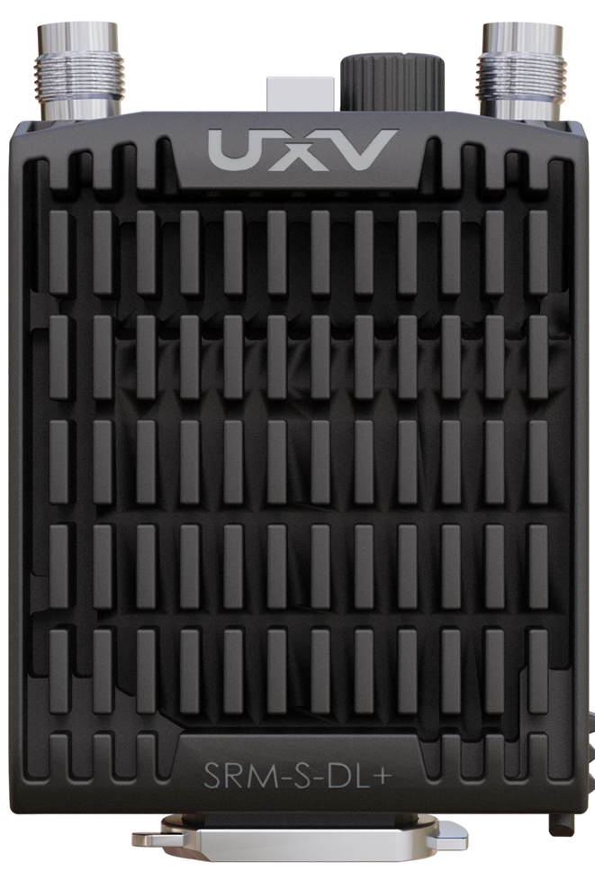
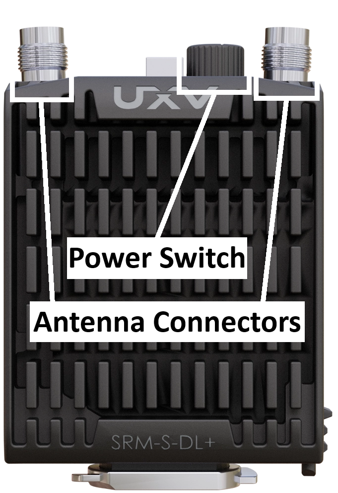
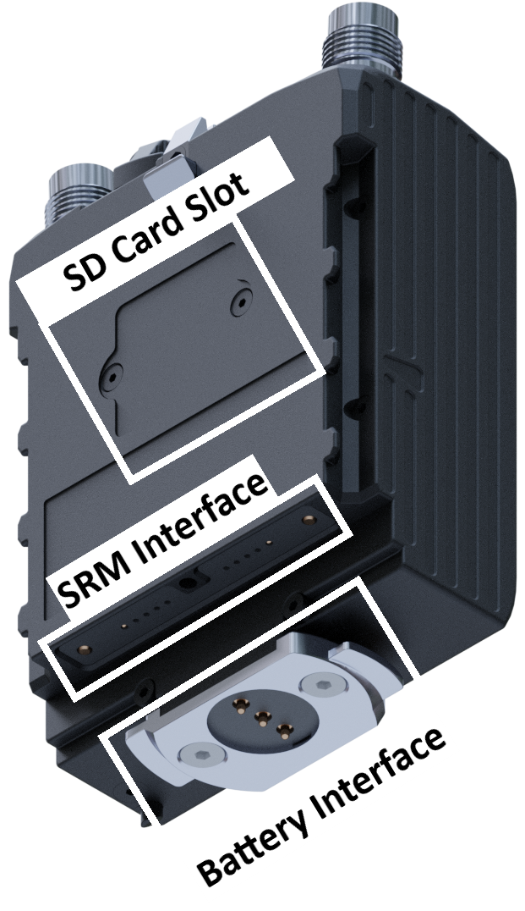

# SRM-S-DL+

The SRM-S-Dl+ integrates a Doodle Labs radio into a ruggedized package with the [SRM Interface](../srm-interface.md).

<figure><figcaption></figcaption></figure>

| Parameter                 | Value                                 |
| ------------------------- | ------------------------------------- |
| Communication Protocols   | Ethernet (+ Serial in special config) |
| Twist-on external battery | Yes                                   |
| SRM Interfacce Power      | Yes                                   |
| Antenna Connectors        | 2x Female TNC Connectors              |

## Hardware Overview

The 2 female [TNC antenna connectors](https://en.wikipedia.org/wiki/TNC_connector) and a 2 position power switch can be found at the top:

<figure><figcaption></figcaption></figure>

The SRM interface connector and external twist-on battery interface can be found at the bottom. An SD card slot can be found on the back side.

<figure><figcaption></figcaption></figure>

## Configuration

1. To configure the SRM-S-DL+ settings on a standard computer, connect it through a ethernet on the [SRM Airside ETH](../../../uxv-technologies-radio-accessories/srm-airside-eth.md). Otherwise use an SRM Interface on any UXV Technologies ground control station.
2. Follow the [Connecting to a Doodle Labs radio](connecting-to-a-doodle-labs-radio.md) guide for software settings.
