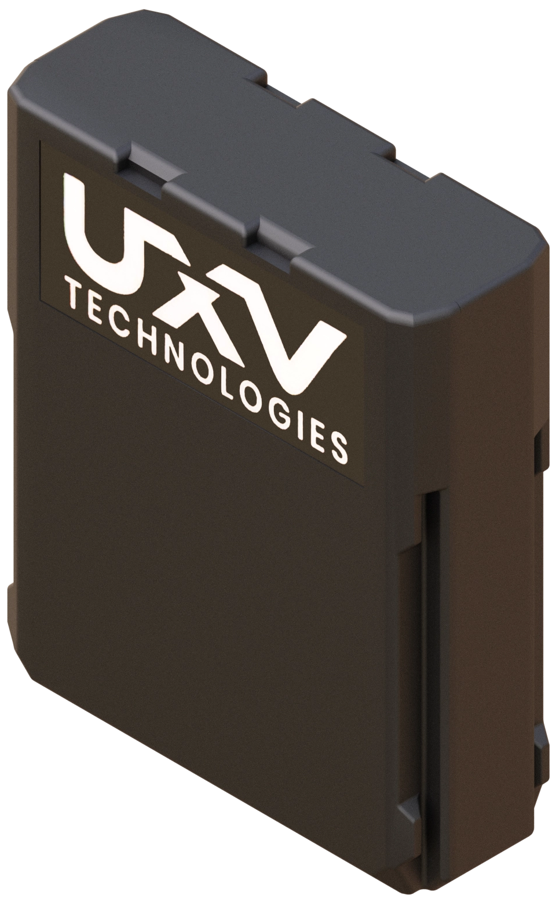

# Accessories for Ground Control Stations

## [Swappable Battery Modules (SBM)](uxv-technologies-swappable-battery-modules.md)

SBMs offer the capability to swap out power to an [SRoC controller](../ground-control-stations/uxv-technologies-sroc-7-windows.md) on the go.

<figure><figcaption></figcaption></figure>
