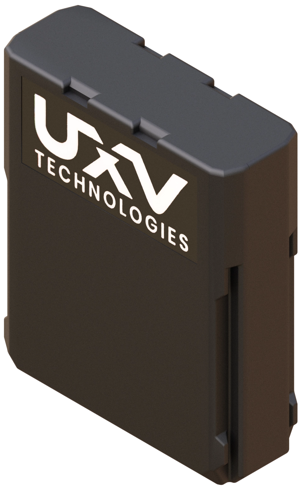
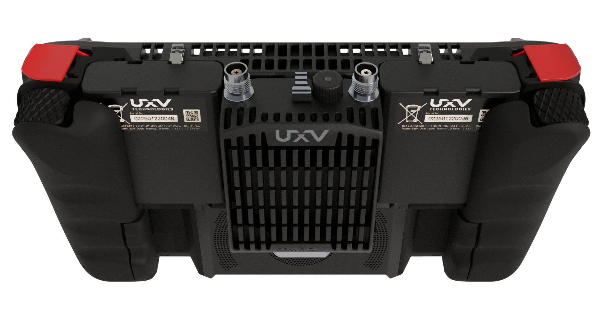

# UXV Technologies Swappable Battery Modules

SBMs slot into the SMB Slots on the UXV Technologies SRoC controller. The operator can swap out the batteries at any time to enable continuous operation in the field.


{% column width="33.33333333333333%" %}
<figure><figcaption></figcaption></figure>



{% column width="66.66666666666667%" %}

<figure><figcaption></figcaption></figure>



The following table describes the data for the SBM UXV 1608 model:

| Metric         | Value       |
| -------------- | ----------- |
| Capacity       | 33.588 Wh   |
| Voltage rating | 10.8 Vdc    |
| Chemistry      | Lithium-Ion |
