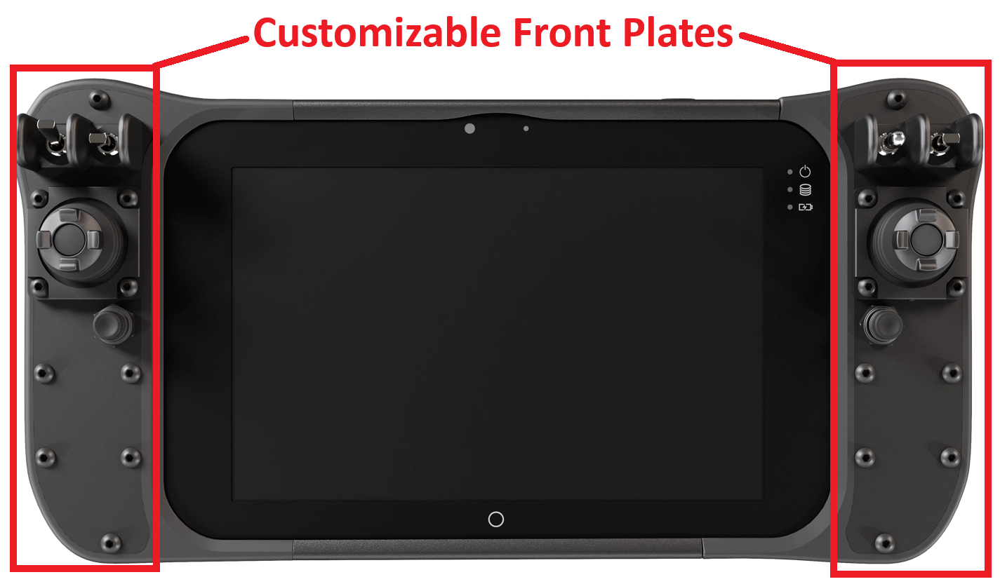

# UXV Technologies Micronav

The UXV Technologies Micronav is an Integrated Ground Control Station (GCS) based on the 7" Panasonic Toughpad FZ-M1 tablet.

<figure><figcaption></figcaption></figure>

The controller is radio-agnostic, meaning the communication links can be swapped. It also offers a high degree of customizabiliy for UXV Technologies customers in terms of joystick and button configurations on the front plates and handles.



<figure><figcaption></figcaption></figure>








* Handles can also have switches/joysticks:

| Specificaton | Value |
| ------------ | ----- |
|              |       |
|              |       |
|              |       |

## Hardware Overview
