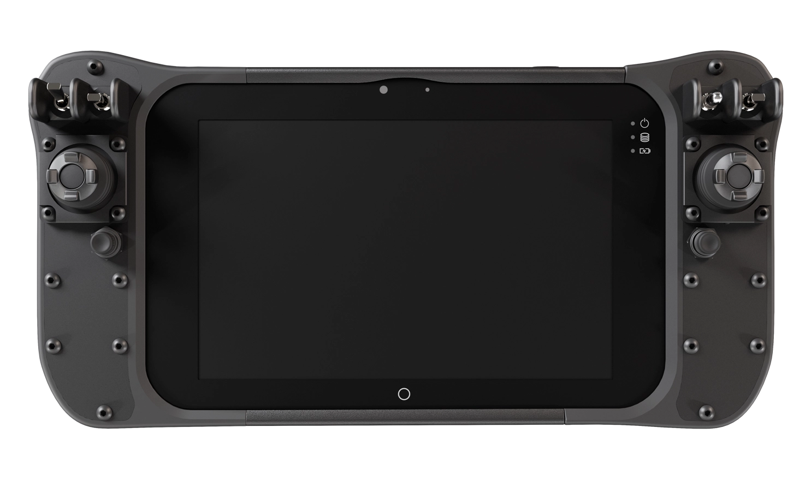
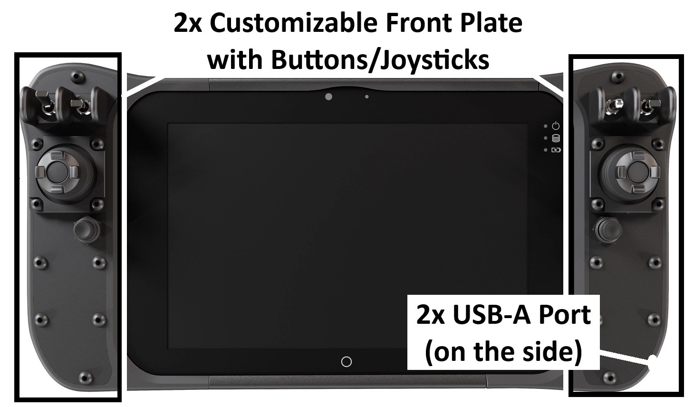

# UXV Technologies Micronav

The UXV Technologies Micronav is an integrated Ground Control Station (GCS) based on the 7-inch Panasonic Toughpad FZ-M1 tablet.

<figure><figcaption></figcaption></figure>

The controller is radio-agnostic, allowing its communication links to be changed. Joystick and button configurations on the front plates and handles can also be customized to meet customer requirements.



<figure><figcaption></figcaption></figure>







| Specification          | Value                                                        |
| ---------------------- | ------------------------------------------------------------ |
| Weight                 |                                                              |
| Screen size            | 7 inches / 17.78 cm                                          |
| Operating system       | Windows 10 / Android (upon customer request)                 |
| CPU                    | Intel® Core™ m5-6Y57 vPro™ processor                         |
| Memory                 | 8 GB SDRAM (LPDDR3)                                          |
| Human interface        | Configured to customer requirements                          |
| Battery                | Panasonic FZ-M1 battery, 3220 mAh                            |
| Charger                | 110–239 V AC/DC, 72 W                                        |
| USB ports              | 2 × USB 2.0 Type-A                                           |
| Communication          | Radio integrated into the controller (upon customer request) |
| Ingress protection     | IP65                                                         |
| Environmental standard | MIL-STD-810G                                                 |
| Output                 | Ethernet, Serial, USB                                        |

## Hardware Overview



<figure><figcaption></figcaption></figure>







## Software

For controller configuration and firmware updates, refer to the [UXVSuite](../uxv-technologies-uxvsuite/) software guide.

If the controller is equipped with a radio, follow the [Doodle Labs](../../uxv-technologies-communication/standalone-radio-guides/connecting-to-a-doodle-labs-radio.md) guide for setup instructions. The radio is already integrated into the controller, so no additional hardware connections are required.

