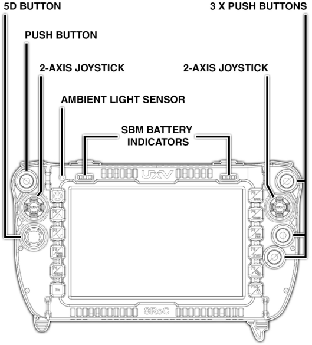
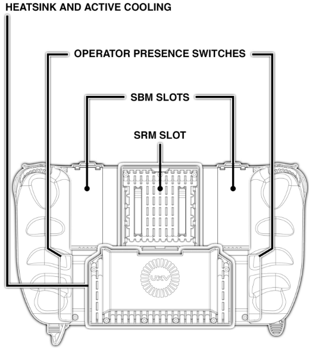
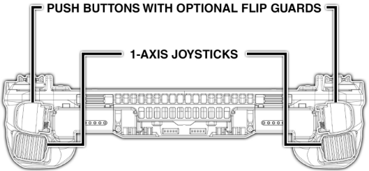
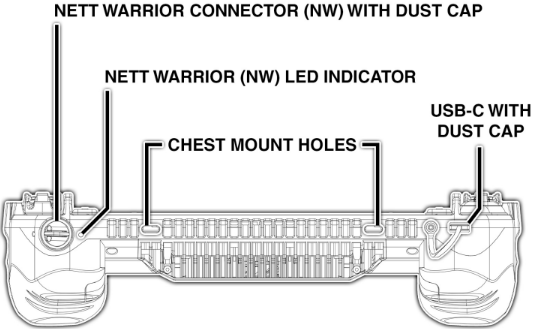
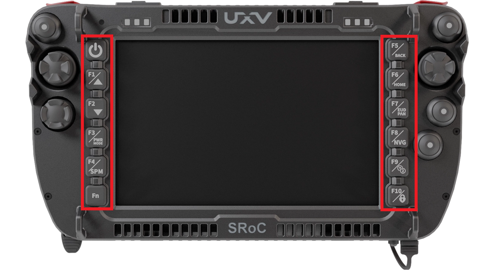
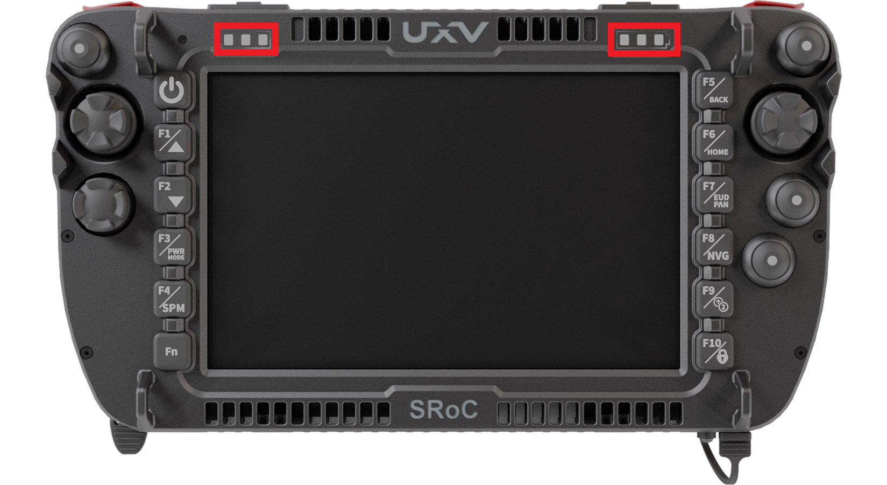
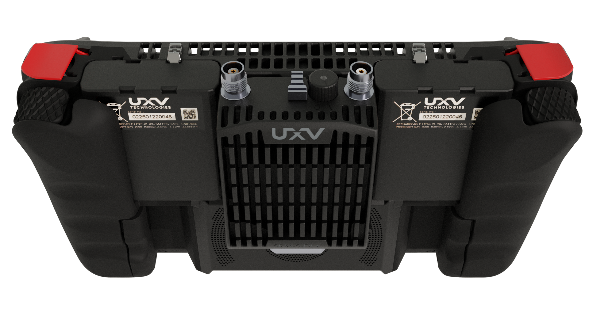
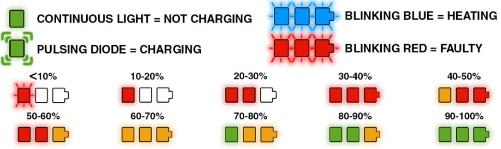

# UXV Technologies SRoC 7" Windows

The UXV Technologies SRoC (Soldier Robotic Controller) 7" Windows is an integrated GCS (Ground Control Station) running _Windows 11_. The unit combines a _Windows_ computer and a gamepad into a single package.

<figure><figcaption></figcaption></figure>

| Specification          | Value                                                                       |
| ---------------------- | --------------------------------------------------------------------------- |
| Display                | 7" touchscreen                                                              |
| Operating system       | Windows 11                                                                  |
| Ingress protection     | IP65                                                                        |
| Environmental standard | MIL-STD-810H                                                                |
| Compliance             | CE, RoHS                                                                    |
| Power sources          | Internal battery, 2 x SBM, Nett Warrior, external battery on SRM (twist-on) |
| Charging               | USB-C, Nett Warrior, SBM, SRM (with twist-on battery attached)              |
| Radio                  | Swappable Radio Module (SRM) slot                                           |
| Inputs                 | Joysticks (2x 2-axis, 2x 1-axis), (6x) Push buttons , (10x) Bezel buttons   |
| Ports                  | USB-C, Nett Warrior                                                         |

### Hardware Overview



<figure><figcaption></figcaption></figure>



<figure><figcaption></figcaption></figure>



<figure><figcaption></figcaption></figure>



<figure><figcaption></figcaption></figure>



### Bezel Buttons

The bezel buttons are located on both sides of the display and are used for firmware or SRoC-specific controls.

<figure><figcaption></figcaption></figure>

* **Power on/off** - Turns the controller on or off.
* **F1/SCREEN/LED BRIGHTNESS UP** - To be implemented.
* **F2/SCREEN/LED BRIGHTNESS DOWN** - To be implemented.
* **F3/PWR MODE** - Cycles through the power sources: Nett Warrior (default) or device-mounted power (internal battery, SBM, Bren-Tronics MBITR battery).
* **F4/SRM** - Turns the power for the SRM socket on or off (default: on).
* **Fn** - Hold to access the function buttons. Hold for 3 seconds to enable FUNCTION LOCK.
* **F5/BACK** - To be implemented.
* **F6/HOME** - To be implemented.
* **F7/END USER DEVICE/PERSONAL AREA NETWORK TOGGLE** - To be implemented.
* **F8/NIGHT VISION** - Turns off all LEDs in the bezel (default: off). The push button LEDs are off by default.
* **F9/DUALRATE TOGGLE** - Decreases the joystick input value by 50% (default: full rate).
* **F10/OPERATOR PRESENCE** - Disables the operator presence functionality (default: enabled).


To enable joystick/button input, the operator presence buttons on the back must be pressed. This helps prevent accidental inputs in high-stress environments. The function can be turned off as described above.


### SBM Battery Indicators

The LED battery indicators show the state of charge of the [SBMs](https://www.uxvtechnologies.com/ground-control-stations/sbm-swappable-battery-module) (Swappable Battery Modules).

<figure><figcaption></figcaption></figure>

Back view with SRM (Swappable Radio Module) and SBMs (Swappable Battery Modules) connected.

<figure><figcaption></figcaption></figure>

The SBMs can be charged through the Nett Warrior desktop charger, the SBM charger, or the USB-C port connected to the SRoC. The chart below shows the state of charge of the batteries:

<figure><figcaption></figcaption></figure>


The SRM-S versions can be powered using the SBMs and the internal battery. The SRM-L, however, consumes more power and requires an external twist-on battery.

