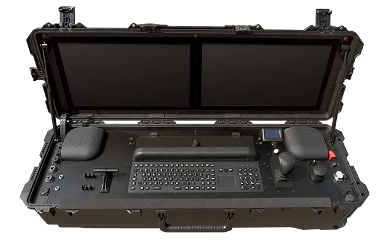
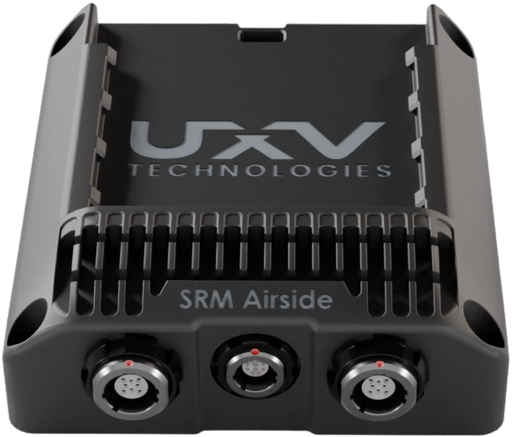

# Overview of UXV Technologies Products

UXV Technologies Products Overview Poster (10/2026)

<figure><figcaption></figcaption></figure>

### [Ground Control Stations (GCS)](ground-control-stations-gcs.md)



<figure><figcaption>
UXV Technologies SRoC 7" Windows
</figcaption></figure>




<figure><figcaption>
UXV Technologies G2Nav
</figcaption></figure>




### [Swappable Radio Modules (SRM)](swappable-radio-modules-srm/)


{% column width="41.66666666666667%" %}
<figure><figcaption>
UXV Technologies SRM-S-MH+
</figcaption></figure>



{% column width="58.33333333333333%" %}
<figure><figcaption>
UXV Technologies SRM Airside ETH
</figcaption></figure>




### [Sensors - Optroxa Gimbal](sensors-optroxa-gimbal/)



<figure><figcaption>
UXV Technologies Optroxa GMB 550
</figcaption></figure>




More coming soon...


